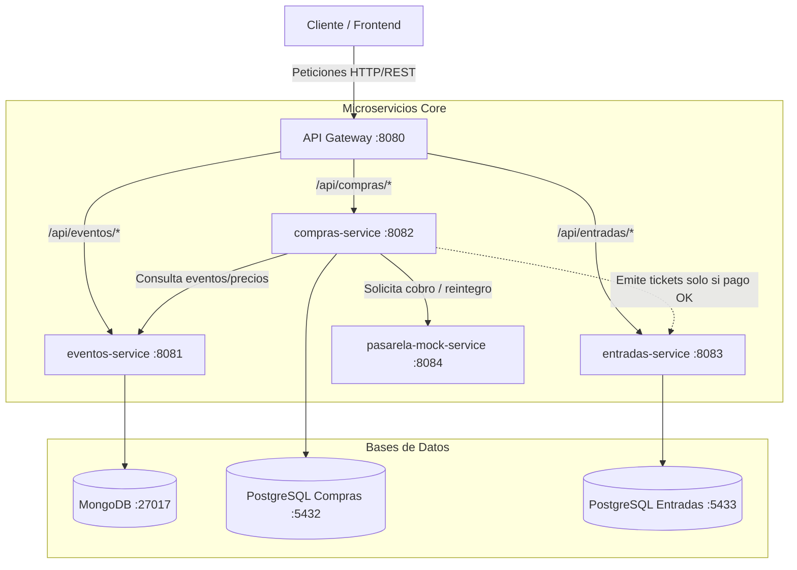
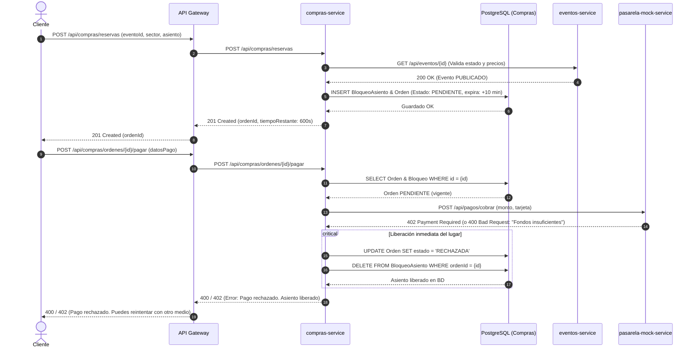
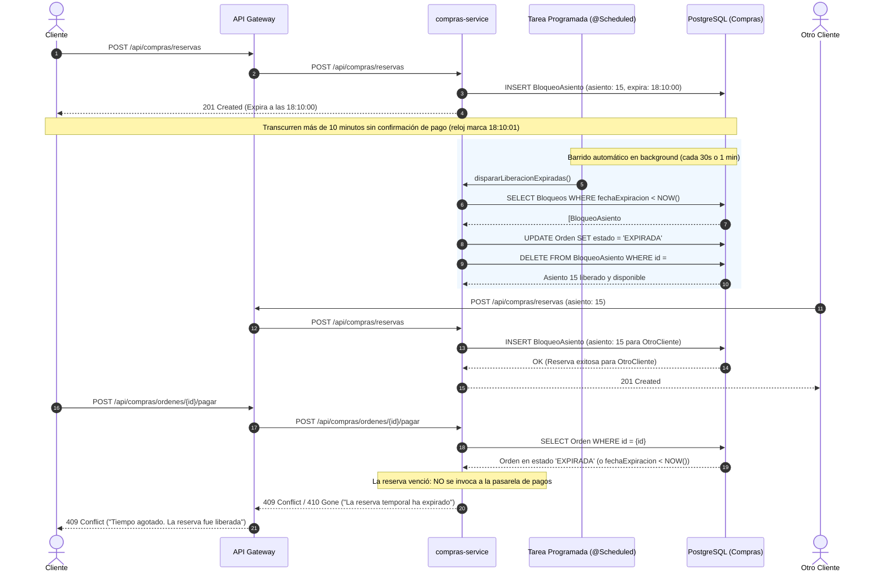

1. Diagrama de Módulos (Componentes del Flujo de Compra)

Este diagrama representa cómo se interconectan los microservicios y bases de datos durante el ciclo de vida de una reserva y compra


2. Diagrama de Secuencia: Compra con Pago Rechazado

Escenario: El cliente bloquea un asiento correctamente, pero la pasarela de pagos rechaza la transacción (por fondos insuficientes, tarjeta inválida, etc.)  El sistema debe actualizar la orden a RECHAZADA y liberar el asiento de inmediato para no retenerlo innecesariamente


---

3. Diagrama de Secuencia: Reserva Vencida (Timeout de los 10 minutos)

Escenario: El cliente genera la reserva temporal, pero abandona la pantalla o tarda más del tiempo límite (ej. 10 minutos) sin completar el pago 
Aquí intervienen dos mecanismos concurrentes 
1. El Job en segundo plano @Scheduled que barre periódicamente y libera los bloqueos expirados.
2. La validación defensiva al intentar pagar tardíamente*, que rechaza la operación informando que la reserva expiró



4. Autenticación y filtro JWT

Escenario Flujo 1: El cliente envía sus credenciales al punto de entrada unico(API Gateway). El servicio verifica la identidad, se construye el JWT firmado con la clave secreta, incrustando en el payload el usuario, la fecha de expiracion y la lista de permisos o roles. Se responde al cliente con el token en formato Bearer.
Escenario Flujo 2: Todas las invocaciones a servicios REST protegidos adjuntan la cabecera Authorization: Bearer <token>. La clase `JWTAuthorizationFilter` intercepta la solicitud HTTP entrante antes de que llegue a los controladores. El filtro invoca a `Jwts.parser()` utilizando la clave secreta compartida para descifrar la firma y comprobar que el token no haya vencido ni haya sido alterado externamente. Si el token es válido, extrae los roles y configura el objeto `UsernamePasswordAuthenticationToken` dentro del `SecurityContextHolder` de Spring. Luego llama a `filterChain.doFilter(...)` para permitir el paso hacia el `RestController`. Si el token es inválido o expirado, se captura la excepción (`ExpiredJwtException`, `MalformedJwtException`), se limpia el contexto de seguridad y se devuelve de inmediato un estado HTTP `401 Unauthorized` o `403 Forbidden`.

```mermaid
sequenceDiagram 
    autonumber 
    actor Cliente as Cliente / Frontend 
    participant Gateway as API Gateway (:8080) 
    participant AuthCtrl as AuthController / Service 
    participant Filter as JWTAuthorizationFilter 
    participant SecContext as SecurityContextHolder 
    participant RestCtrl as Microservicio (RestController) 
    participant DB as Base de Datos 
    

    %% FLUJO 1: AUTENTICACIÓN (LOGIN) 

    rect rgb(235, 245, 255) 
        note over Cliente, DB: Flujo 1: Autenticación y Emisión de Token (POST /api/auth/login) 
        Cliente->>Gateway: POST /api/auth/login {username, password} 
        Gateway->>AuthCtrl: Rutea solicitud de login 
        AuthCtrl->>DB: Consultar usuario y clave encriptada (con salt) 
        DB-->>AuthCtrl: Devuelve registro de usuario y credenciales 
        alt Credenciales Válidas 
            AuthCtrl->>AuthCtrl: Validar hash de contraseña (PasswordUtils / BCrypt) 
            AuthCtrl->>AuthCtrl: Generar JWT (Jwts.builder) con subject, roles y expiración 
            AuthCtrl-->>Gateway: 200 OK { token: "Bearer eyJhbGci..." } 
            Gateway-->>Cliente: 200 OK { token: "Bearer eyJhbGci..." } 
        else Credenciales Inválidas 
            AuthCtrl-->>Gateway: 401 Unauthorized { error: "Credenciales incorrectas" } 
            Gateway-->>Cliente: 401 Unauthorized 
        end 
    end
    
  
    %% FLUJO 2: AUTORIZACIÓN Y PETICIÓN PROTEGIDA 
  
    rect rgb(240, 250, 240) 
        note over Cliente, RestCtrl: Flujo 2: Petición Protegida con Filtro JWTAuthorizationFilter 
        Cliente->>Gateway: GET/POST /api/recurso-protegido<br/>Header Authorization: Bearer <token>
        Gateway->>Filter: Rutea petición hacia el microservicio de destino 
        Filter->>Filter: Verificar presencia de encabezado "Authorization" 
        alt Token Ausente, Expirado o Firma Inválida
            Filter->>SecContext: SecurityContextHolder.clearContext() 
            Filter-->>Gateway: 401 Unauthorized / 403 Forbidden 
            Gateway-->>Cliente: 401 / 403 HTTP Error Response
        else Token Válido y Firmado Correctamente
            Filter->>Filter: Desencriptar y parsear claims (Jwts.parser con secretKey) 
            Filter->>Filter: Extraer subject y permisos ("authorities") 
            Filter->>SecContext: setAuthentication(UsernamePasswordAuthenticationToken) 
            Filter->>RestCtrl: filterChain.doFilter(request, response) 
            RestCtrl->>DB: Procesar lógica de negocio del endpoint 
            DB-->>RestCtrl: Devuelve resultado 
            RestCtrl-->>Gateway: 200 OK / 201 Created (JSON Response) 
            Gateway-->>Cliente: 200 OK / 201 Created (JSON Response)
        end 
    end
```
