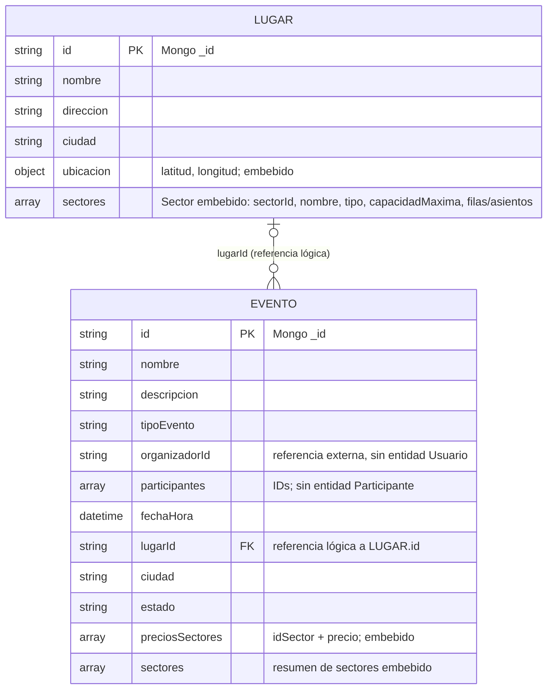
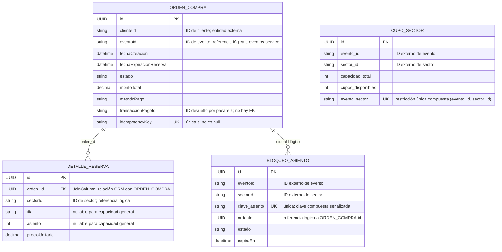
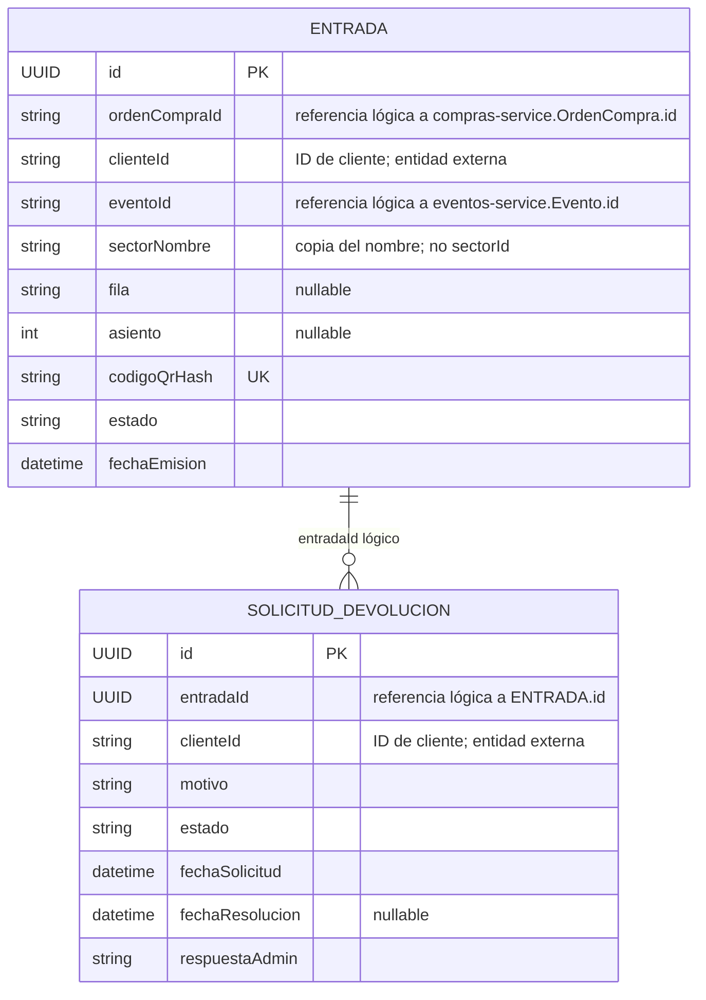
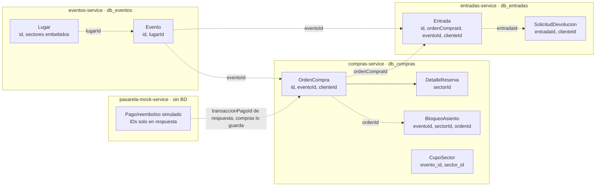

# TicketYa — diagramas entidad-relación por microservicio

Diagramas derivados de las entidades/modelos y configuración del repositorio. Las líneas discontinuas representan referencias entre servicios por identificadores; no son claves foráneas ni implican acceso directo a otra base. Las relaciones sólidas representan vínculos dentro de la persistencia del servicio.

## Persistencia por servicio

| Servicio | Base / almacenamiento | Entidades persistidas |
| --- | --- | --- |
| `eventos-service` | MongoDB `db_eventos` | `Evento`, `Lugar`; sectores, precios, filas y asientos son documentos embebidos/listas. |
| `compras-service` | PostgreSQL `db_compras` | `OrdenCompra`, `DetalleReserva`, `CupoSector`, `BloqueoAsiento`. |
| `entradas-service` | PostgreSQL `db_entradas` | `Entrada`, `SolicitudDevolucion`. |
| `pasarela-mock-service` | Sin persistencia configurada | No hay entidades persistentes. Las respuestas de pago/reembolso son simuladas y no se almacenan. |
| `api-gateway` | Sin persistencia | Enruta solicitudes; no contiene entidades de negocio. |

## 1. eventos-service — MongoDB `db_eventos`

**Claves y relaciones.** `id` es el identificador Mongo (`_id`) de cada documento. `Evento.lugarId` identifica un documento `Lugar`, pero no se declara una referencia Mongo ni una clave foránea. Un lugar puede relacionarse con cero o varios eventos; cada evento contiene un `lugarId` escalar. Sectores, precios, ubicación, filas y asientos no son colecciones independientes en este modelo: están embebidos.

## 2. compras-service — PostgreSQL `db_compras`

**Claves y relaciones.** Las PK son UUID. `DetalleReserva.orden_id` es la relación ORM declarada mediante `@OneToMany`/`@JoinColumn`. `BloqueoAsiento.ordenId` es un UUID que vincula lógicamente el bloqueo con su orden, sin relación JPA declarada. `CupoSector` tiene unicidad compuesta `(evento_id, sector_id)`; `BloqueoAsiento.clave_asiento` e `OrdenCompra.idempotencyKey` tienen unicidad. `eventoId`, `sectorId`, `clienteId` y `transaccionPagoId` son valores escalares; no se declaran FK a otros servicios.

## 3. entradas-service — PostgreSQL `db_entradas`

**Claves y relaciones.** Ambas entidades usan PK UUID. `Entrada.codigoQrHash` es único. `SolicitudDevolucion.entradaId` y `clienteId` no tienen una asociación JPA/FK declarada; el servicio busca la entrada por su UUID y aplica reglas de devolución. Una entrada puede tener cero o varias solicitudes históricas; el servicio impide más de una pendiente para la misma entrada. `ordenCompraId` y `eventoId` refieren a IDs de otras bases, sin FK.

## 4. pasarela-mock-service y api-gateway

No hay ERD persistente: ninguno configura una base de datos ni declara entidades persistentes. La pasarela crea IDs de transacción/reembolso para las respuestas simuladas, pero no guarda pagos. `compras-service` conserva `transaccionPagoId` en `OrdenCompra`; no se ha encontrado almacenamiento de la otra parte en pasarela.

## Relaciones entre servicios

Las flechas discontinuas entre servicios representan IDs intercambiados por API. El flujo documentado en código incluye consultas de compras a eventos y pasarela, emisión de entradas desde compras, y consultas de eventos desde entradas. Las flechas punteadas del dibujo muestran la relación semántica de datos, no necesariamente una llamada unidireccional. El modelo de entradas usa `sectorNombre` en vez de `sectorId`, por lo que no mantiene una clave directa al sector del catálogo.

## Entidades o datos solapados entre bases

| Dato/entidad conceptual | Dónde aparece | Tipo de solapamiento |
| --- | --- | --- |
| Evento | `db_eventos.Evento.id`; `db_compras.OrdenCompra.eventoId`, `CupoSector.evento_id`, `BloqueoAsiento.eventoId`; `db_entradas.Entrada.eventoId` | El evento es dueño del catálogo en Eventos. Compras y Entradas guardan referencias/copiados de su ID, no una entidad Evento local ni una FK entre bases. |
| Sector | Embebido en `Lugar.sectores`; resumido también en `Evento.sectores` y `Evento.preciosSectores`; IDs en `DetalleReserva`, `CupoSector`, `BloqueoAsiento`; texto `Entrada.sectorNombre` | Hay solapamiento real de información: el resumen/ precio en `Evento` duplica parcialmente el sector definido en `Lugar`; compras guarda IDs para reserva/cupo y entradas copia el nombre. No hay tabla/colección Sector independiente. |
| Orden de compra | `db_compras.OrdenCompra.id`; `db_entradas.Entrada.ordenCompraId`; además `BloqueoAsiento.ordenId` en Compras | Una sola entidad propietaria en Compras. Entradas conserva el identificador asociado, sin duplicar los datos de la orden ni declarar FK. |
| Cliente | `OrdenCompra.clienteId`; `Entrada.clienteId`; `SolicitudDevolucion.clienteId` | Identificador repetido entre bases/entidades. No existe servicio o entidad Cliente en el repositorio inspeccionado. |
| Transacción de pago | `OrdenCompra.transaccionPagoId`; la pasarela genera `transaccionId` como respuesta | El ID queda persistido en Compras; la pasarela mock no mantiene una entidad/transacción persistida. |

### Lectura recomendada

Hay tres dominios con datos persistidos (`eventos`, `compras`, `entradas`) y dos servicios sin persistencia (`pasarela-mock`, `api-gateway`). No existe una base compartida desde el punto de vista de los servicios: aunque compras y entradas usan el mismo servidor PostgreSQL, están configurados en bases separadas (`db_compras` y `db_entradas`). Los IDs cruzados deben tratarse como referencias de API y consistencia eventual, no como integridad referencial garantizada por SQL.
